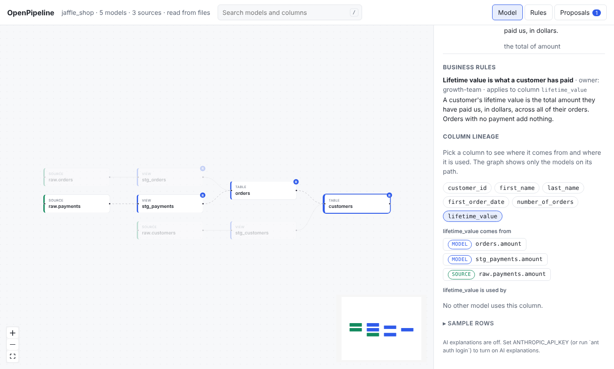

# OpenPipeline

**See what your dbt project does, in plain English. Review every change before it lands.**

Live demo: <https://openpipeline.vercel.app/demo/>

OpenPipeline opens a dbt project you already have and gives everyone, not just the
people who wrote the SQL, a way to understand it and to review changes to it,
whether a teammate or an AI agent made them. It never runs dbt, never connects to
your warehouse, and reads and writes plain dbt files, so you can stop using it at
any time.


## Try it in one minute

```bash
pip install openpipeline
openpipeline demo
```

This copies the bundled jaffle_shop example to a temporary folder, files one
pending proposal from an imaginary agent, and starts the server at
<http://127.0.0.1:8484>. Open the **Proposals** tab and press **Show on graph** to
see a review.

## What you get

- **Model graph.** Every model and source as an interactive map. Click one to
  light up everything it reads from and everything that depends on it.
- **Story view.** Each model explained step by step in plain words: where the data
  comes from, how it is joined and filtered, what one row means, and how each
  column is worked out.
- **AI explanations (optional).** Bring your own Anthropic key to get a friendlier
  write-up and suggested descriptions. Nothing is sent unless you click the button.
- **Editable docs.** Fix descriptions in the UI. They are saved into your own YAML
  files and the comments in them are kept.
- **Sample rows.** Run a model on small local sample data in an in-memory DuckDB and
  see real rows. No warehouse involved.
- **Search and column lineage.** Press `/` to find any model, source, or column.
  Pick a column to see where it comes from and what uses it.
- **Business rules.** Name the rules buried in your SQL, give each an owner, and link
  them to the models and columns that carry them.
- **PR summaries.** A GitHub Action comments on pull requests with what changed in
  business terms, what is affected downstream, and which owners to loop in.
- **Safe changes from AI agents.** An MCP server lets agents such as Claude read
  the project and *propose* changes. You review each proposal on the graph, comment,
  and accept or reject it. Nothing is written until a person accepts.

<p>
  
  
</p>

## Use it on your own project

```bash
openpipeline serve path/to/your/dbt/project
# open http://127.0.0.1:8484
```

With Docker:

```bash
docker run --rm -p 8484:8484 -v "$PWD:/project" ghcr.io/pawanpatil19/openpipeline
```

You do not need dbt installed or warehouse credentials. OpenPipeline reads
`target/manifest.json` when it exists (run `dbt parse` for the most accurate
results) and otherwise reads your SQL and YAML files directly.

Optional extras:

```bash
pip install 'openpipeline[ai]'        # AI explanations, with your own Anthropic key
pip install 'openpipeline[preview]'   # sample rows, run locally with DuckDB
```

## Connect an AI agent

```bash
claude mcp add openpipeline -- openpipeline mcp /path/to/dbt/project
```

The agent can look at everything, but it can only propose edits. It reads with
`explain`, `search`, `column_lineage`, `impact_of`, and `list_rules`, checks its work
with `preview_change` and `sample_rows`, and files changes with `propose_change`
or `propose_docs`. See [Working with AI agents](https://openpipeline.vercel.app/docs/guides/ai-agents/).

## Command line

```bash
openpipeline demo                        # the example project plus a proposal to review
openpipeline serve [PROJECT]             # web UI and API on :8484
openpipeline explain customers [PROJECT] # explain one model (add --ai for an AI write-up)
openpipeline lineage customers lifetime_value [PROJECT]
openpipeline sample customers [PROJECT]  # a few rows, on sample data
openpipeline rules [PROJECT]             # business rules, grouped by owner
openpipeline review BASE HEAD            # Markdown summary of a change, for a PR
openpipeline mcp [PROJECT]               # MCP server for agents
```

`PROJECT` defaults to the current folder or `$OPENPIPELINE_PROJECT_DIR`. Run any
command with `--help` for its options.

## Documentation

Guides, the command line, HTTP API, and configuration reference are at
**<https://openpipeline.vercel.app/docs/>**.

## How it is built

| Part | Path | Stack |
| --- | --- | --- |
| Engine | [`packages/core`](packages/core) | Python, sqlglot, pydantic |
| App (CLI, API, MCP) | [`apps/server`](apps/server) | FastAPI, Typer, MCP Python SDK |
| Web UI | [`apps/web`](apps/web) | React, TypeScript, Vite, React Flow |
| PR summary action | [`actions/pr-summary`](actions/pr-summary) | GitHub composite action |
| Example project | [`examples/jaffle_shop`](examples/jaffle_shop) | dbt |

Read [docs/architecture.md](docs/architecture.md) for how the parts fit.

## Status

Version 1.0. The features above are stable and covered by tests. Bug reports and
ideas are welcome in the [issue tracker](https://github.com/PawanPatil19/openpipeline/issues).

## Contributing

[CONTRIBUTING.md](CONTRIBUTING.md) explains how to set up the project and run the
checks. In short:

```bash
make install   # Python and web dependencies, plus git hooks
make dev       # API with reload on :8484, web dev server on :5173
make lint typecheck test
```

## License

[Apache 2.0](LICENSE)
