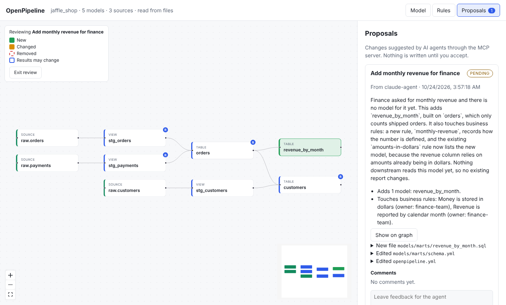

# Working with AI agents

OpenPipeline includes an [MCP](https://modelcontextprotocol.io) server. It lets an
AI agent such as Claude read your dbt project and *propose* changes. An agent can
look at everything, but it can only propose edits. Nothing is written to your dbt
files until a person accepts.

## Connect an agent

=== "Claude Code"

    ```bash
    claude mcp add openpipeline -- openpipeline mcp /path/to/dbt/project
    ```

    Check it with `claude mcp list`. If you installed with `uvx`, use
    `-- uvx openpipeline mcp /path/to/dbt/project`.

=== "Other clients (stdio)"

    Most MCP clients take a JSON config like this:

    ```json
    {
      "mcpServers": {
        "openpipeline": {
          "command": "openpipeline",
          "args": ["mcp", "/path/to/dbt/project"]
        }
      }
    }
    ```

=== "Other clients (HTTP)"

    Run the server as a service, then give your client the URL:

    ```bash
    openpipeline mcp /path/to/dbt/project --transport streamable-http
    # listening on http://127.0.0.1:8485/mcp
    ```

    With Docker Compose, the `mcp` service already does this on port 8485.

    On a loopback address the endpoint is open. On any other address (including
    Docker and Compose) it needs `Authorization: Bearer <token>`; set `--token` or
    `OPENPIPELINE_TOKEN`, or read the generated one from the startup output. The
    stdio setup above is local-only and needs no token. Agents can only propose
    either way. See [Write access and security](../reference/security.md).

!!! tip
    Run `openpipeline serve` on the same project at the same time. Agents file
    proposals and you review them in the web UI.

## The propose, review, accept loop

1. **The agent reads.** It calls `explain` to understand a model, `impact_of` to
   see what depends on it, `column_lineage` before it touches a column, and
   `list_rules` to learn which business rules exist.
2. **The agent checks its work.** It calls `preview_change` with the new file
   contents. This is a dry run. It reports new warnings and the models that would
   be affected, so the agent can fix mistakes before you see them.
3. **The agent proposes.** It calls `propose_change`. The proposal appears in the
   **Proposals** tab with a plain-English summary and a readable diff for each
   file.
4. **You review.** Press **Show on graph** to see the result: new models in green,
   changed models in amber, removed models as red dashed ghosts, and models whose
   results may change with an outline. Click any box to read its story.

    

5. **You decide.** Press **Accept and write files**, or **Reject** with a reason.
   You can also leave comments.
   The agent reads them with `get_proposal`.
6. **The agent revises.** If you asked for changes, it calls `propose_change`
   again with `revises` set to the old proposal. The old one is marked
   superseded.

If someone edits a file after a proposal was made, accepting shows which files
changed. You can then choose **Accept anyway**.

Proposals are plain JSON files in `.openpipeline/proposals` inside your project,
so you can read, commit, or delete them by hand.

!!! info "The one rule"
    There is no tool that writes to your dbt files. The only way a file changes is
    a person pressing Accept (or Save, when editing a description in the UI).

## Tool reference

| Tool | What it does | Arguments |
| --- | --- | --- |
| `list_models` | Every model with its description, owner, and path. | none |
| `get_model` | A model's SQL, columns, config, direct dependencies, and rules. | `name` |
| `explain` | The plain-English story of a model, step by step. | `name` |
| `impact_of` | Models upstream of, and affected downstream by, a model. | `name` |
| `list_rules` | The business rules and who owns them. | none |
| `search` | Find models, sources, seeds, and columns by name or description. | `query`, `limit` |
| `column_lineage` | Which columns a column is built from, and which use it. Call it before renaming or removing a column. | `model`, `column` |
| `sample_rows` | A few rows of a model, run on local sample data. Never touches the warehouse. | `name`, `limit` |
| `preview_change` | Dry run of a change: summary, added, changed, removed, affected, warnings. Saves nothing. | `files` |
| `propose_change` | File a proposal for a person to review. | `title`, `rationale`, `files`, `author`, `revises` |
| `propose_docs` | Propose a new model description or column descriptions. | `model`, `description`, `columns`, `rationale`, `author` |
| `get_proposal` | A proposal's status and the comments people left on it. Poll after proposing. | `id` |
| `list_proposals` | All proposals and whether each is pending, accepted, rejected, or superseded. | none |

Defaults: `limit` is `10` for `sample_rows` (up to 200) and `20` for `search`, and
`author` is `agent`. `get_proposal` and `list_proposals` report status as
`pending`, `accepted`, `rejected`, or `superseded`.

`files` is always a list of `{"path": "...", "content": "..."}` with the *full*
new content of each file, relative to the project root. Empty content deletes the
file. Paths outside the project, or inside `.git` or `.openpipeline`, are
refused.

## Writing good proposals

Tell your agent to:

- explain *why* in the rationale, in plain words a business reader understands,
- name every business rule the change touches,
- run `preview_change` first and fix its warnings, and
- call `column_lineage` before changing a column.

The [demo](../reference/cli.md#openpipeline-demo) shows what a good proposal looks
like.
