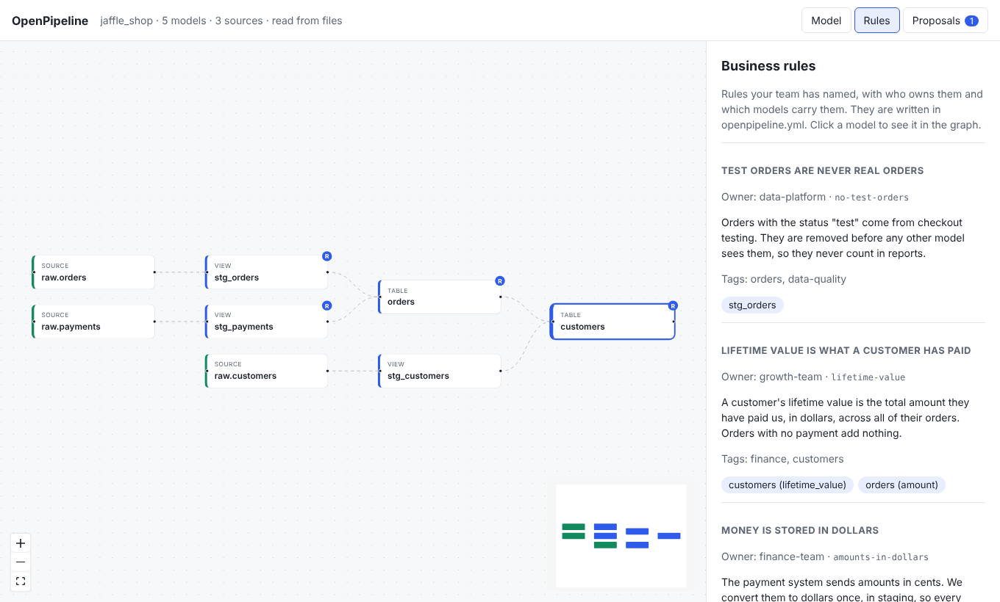

# Business rules

Every team has rules that live only inside SQL: "test orders never count", "an
order is revenue only once it has shipped", "money is stored in dollars".
OpenPipeline lets you name those rules in one place, say who owns each one, link
them to the models and columns that carry them, and flag them whenever a change
touches them.



## Write a rule

Rules live in `openpipeline.yml` at the root of your dbt project, next to
`dbt_project.yml`. The file is part of your project, so it is versioned and
reviewed like any other file.

```yaml
rules:
  - id: lifetime-value
    name: Lifetime value is what a customer has paid
    description: >
      The total a customer has paid us, in dollars, across all orders.
    owner: growth-team
    applies_to:
      - model: customers
        columns: [lifetime_value]
```

You can also link from dbt's own YAML, on a model or on a column:

```yaml
models:
  - name: orders
    columns:
      - name: amount
        meta:
          rules: [lifetime-value]
```

The full list of fields is on the [rules file format](../rules.md) page.

## Where you see them

- The **Rules** tab lists every rule with its owner, description, and linked
  models. Click a model to open it on the graph.
- The model panel has a **Business rules** section.
- Graph boxes for models that carry a rule show a small **R** badge.
- `openpipeline rules` prints the rules grouped by owner.
- [PR summaries](pr-summaries.md) list the rules a change touches, and add the
  rule owners to "Owners to loop in".
- [AI agents](ai-agents.md) read the rules with `list_rules` and are told to name
  any rule a change touches in the rationale of their proposal.

## Who it is for

Business readers get a plain list of the promises the data makes, with a name to
ask. Data engineers get a short checklist on every pull request: "this change
touches the shipped-revenue rule, so loop in finance".

If something is wrong in the rules file, your project still loads and a warning
shows in the banner. See [the rules page](../rules.md) for the list of warnings.
