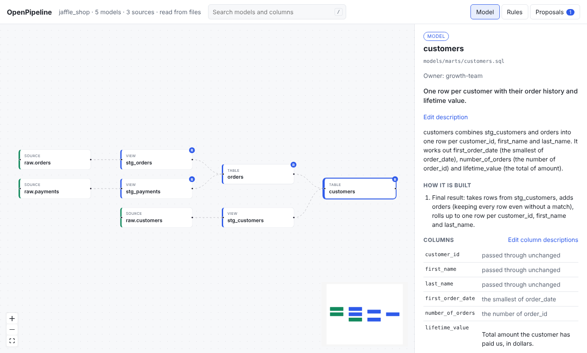

# Reading the graph and stories

## The graph

The main screen is a map of your project. Sources are on the left, staging
models in the middle, and the models people use in reports on the right. Lines
show which model reads from which.


- **Click a box** to open that model in the side panel. The graph dims
  everything that is not connected to it, so you can see what it reads from and
  what depends on it.
- **Drag and scroll** to move around. The small map in the corner shows where
  you are.
- A small **R** badge on a box means the model carries a
  [business rule](business-rules.md).
- The top bar tells you how many models and sources were found, and whether they
  were read from the manifest or from your files.

If something could not be read, a yellow banner at the top lists the warnings.

## The story

Select a model and the side panel tells its story.



From top to bottom:

1. **Description.** The text from your dbt YAML, if you wrote one. You can
   [edit it right here](editing-descriptions.md).
2. **Explain with AI**, if you [turned it on](ai-explanations.md).
3. **Summary.** One paragraph that says what the model produces: its grain (one
   row per what), and what its main columns mean.
4. **How it is built.** Numbered steps in plain words: where the data comes from,
   how tables are joined, what is filtered out, and how rows are rolled up.
5. **Columns.** For each column, your description and how it is worked out
   ("the total of amount", "passed through unchanged").
6. **Business rules.** The [business rules](business-rules.md) the model carries.
7. **Column lineage** and **Sample rows**. See
   [Search and column lineage](search-and-lineage.md) and
   [Sample rows](sample-rows.md).
8. **If this changes, these are affected.** The models downstream of it.

The story is built from the structure of the SQL. It is instant, free, and
private, because nothing is sent anywhere. For a more natural write-up, you can
turn on [AI explanations](ai-explanations.md) as an extra.

## On the command line

```bash
openpipeline explain customers            # the story, in the terminal
openpipeline explain customers --json     # the same, as JSON
openpipeline graph                        # the whole graph, as JSON
```

## Limits to know about

- When OpenPipeline reads plain files, it understands `ref()`, `source()`, and
  `config()`. Other Jinja (macros, `var()`, loops) cannot be read, and the story
  for that model says so. Run `dbt parse` to switch to the manifest. See the
  [FAQ](../faq.md).
- A story describes what the SQL does. It cannot know why. Add the why to the
  description, or name it as a [business rule](business-rules.md).
