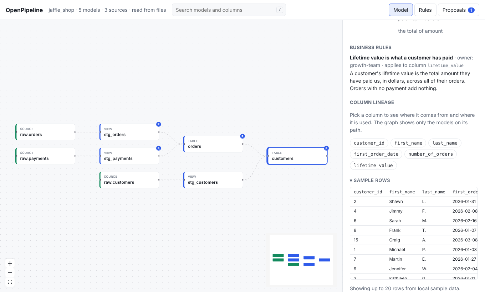

# Sample rows

Seeing a few rows is the fastest way to understand a model. OpenPipeline can run
a model's SQL on small sample data, on your own machine, in an in-memory
[DuckDB](https://duckdb.org).

- It never connects to your warehouse.
- It never writes to disk.
- A preview that runs longer than five seconds is stopped.

## Turn it on

The Docker image includes it. With pip, add the extra:

```bash
pip install 'openpipeline[preview]'
```

Then open a model in the UI and expand **Sample rows**, or run:

```bash
openpipeline sample customers
```



Without DuckDB the section is still there, and tells you how to install it.

Agents can call the `sample_rows` tool to sanity-check their own logic. See
[Working with AI agents](ai-agents.md).

## Where the sample data comes from

OpenPipeline looks in these places, in order.

1. **Seeds.** Each CSV in your `seed-paths` becomes a table named after the file.
2. **A sample data folder.** By default this is `sample_data/` in your project.
   Use `--sample-data PATH` or `OPENPIPELINE_SAMPLE_DATA` to point somewhere
   else.
3. **A DuckDB file.** Pass a `.duckdb` file the same way. It is opened
   read-only. Put each source's tables in a schema named after the source.

### The sample_data convention

Name each file `<source>.<table>.csv` or `.parquet`. The file stands in for the
dbt source of the same name:

| File | Backs |
| --- | --- |
| `sample_data/raw.orders.csv` | `source('raw', 'orders')` |
| `sample_data/raw.customers.parquet` | `source('raw', 'customers')` |

Keep the files small. A few dozen rows that show the interesting cases are better
than a big export, and they are safe to commit. The
[jaffle_shop example](https://github.com/PawanPatil19/openpipeline/tree/main/examples/jaffle_shop/sample_data)
has sample data for all of its models.

## How a preview runs

OpenPipeline builds every model upstream of the one you picked, using your own
SQL, then shows up to 20 rows (200 at most). If a table is missing, it tells you
which file to add.

Set `--dialect` or `OPENPIPELINE_DIALECT` (for example `snowflake` or
`bigquery`) so the SQL is read in your warehouse's dialect.

Rows come back in whatever order DuckDB produces them, so two runs of a model
without an `order by` can show them in a different order.

## Set it once for the team

Instead of passing flags, add a `preview:` section to `openpipeline.yml`:

```yaml
preview:
  sample_data: sample_data   # a folder or a .duckdb file, relative to the project
  dialect: snowflake
```

A flag wins over an environment variable, and an environment variable wins over
the file.

## What cannot be previewed

OpenPipeline does not run dbt, so it cannot run Jinja. Models that use macros,
`var()`, or other Jinja beyond `ref()` and `source()` cannot be previewed, and the
panel says so. Functions that only exist in your warehouse may also fail in
DuckDB. See the [FAQ](../faq.md).

The numbers you see come from sample data. They show what the model does, not
what is in production.
