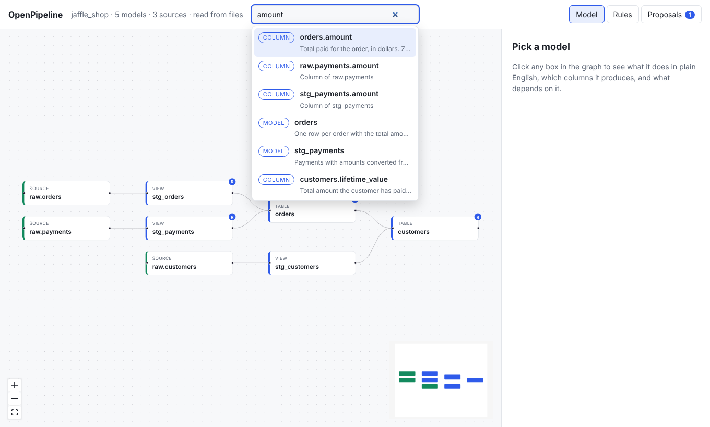

# Search and column lineage

## Search

Press `/` (or `Ctrl+K`, `Cmd+K` on a Mac) to open the search box. Type part of a
name or a description and OpenPipeline finds matching models, sources, seeds, and
columns. The best matches come first. Use the arrow keys and Enter, or click, to
pick one. Press Escape to close the box.



Picking a model or source opens it on the graph. Picking a column opens its model
and traces the column.

Search is useful when you know a business word, such as "refund", but not which
model holds it.

## Column lineage

The graph shows which model feeds which. Column lineage goes one level deeper: it
shows which *columns* a column is built from, and which columns use it.

1. Select a model.
2. In the **Column lineage** section, pick a column.
3. The panel lists where the column comes from (upstream) and where it is used
   (downstream), nearest first and across every hop. The graph lights up only
   that path.


Click any column in the lists to jump to it. Click the selected column again to
clear it.

This answers questions such as "if I rename `amount` in `orders`, what could
break?" and "where does `lifetime_value` really come from?".

It is built by reading your SQL, so it works without a warehouse.

## On the command line

```bash
openpipeline lineage customers lifetime_value
openpipeline lineage customers lifetime_value --json
```

## For agents

Agents have a `search` tool and a `column_lineage` tool. They are told to call
`column_lineage` before they rename, remove, or change the meaning of a column.
Everything under `downstream` may break. See
[Working with AI agents](ai-agents.md).

## HTTP

```text
GET /api/search?q=revenue&limit=20
GET /api/models/{name}/columns
GET /api/models/{name}/columns/{column}/lineage
```

See the [HTTP API](../reference/api.md).
