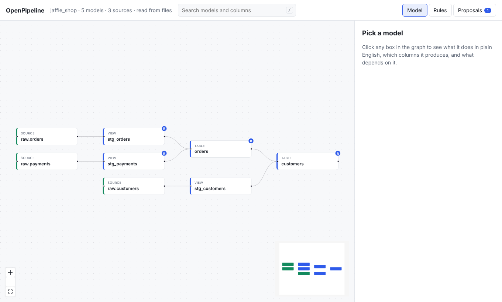

# OpenPipeline

**See what your dbt project does, in plain English. Review every change before it lands.**



OpenPipeline opens a dbt project you already have. It shows every model and
source on a map, explains each model in plain words, and gives you a safe way to
review changes, whether a teammate or an AI agent wrote them.

## The 30-second pitch

- **For business readers.** Click a box and read what the model does, where its
  data comes from, and what one row means. No SQL needed. Business rules, such
  as "revenue counts once an order has shipped", are named, owned, and linked to
  the models that carry them.
- **For data engineers.** Nothing to migrate. OpenPipeline reads your plain dbt
  files (or `target/manifest.json`) and writes plain dbt files. It does not run
  dbt and needs no warehouse credentials. Stop using it any time and your
  project is exactly as it was.
- **For AI agents.** An MCP server lets agents such as Claude read the project
  and *propose* changes. A person reviews each proposal on the graph and accepts
  or rejects it. Agents never write to your project directly.

## Try it in one command

```bash
pip install openpipeline
openpipeline demo
```

This copies the bundled jaffle_shop example to a temporary folder, files one
pending proposal from an imaginary agent, and starts the server at
<http://127.0.0.1:8484>. Open the **Proposals** tab and press **Show on graph**
to see a review.


## Use it on your own project

```bash
openpipeline serve path/to/your/dbt/project
```

Then open <http://127.0.0.1:8484>. See [Getting started](getting-started.md) for
pip, Docker, and Compose.

## What is in the box

| You want to | Go to |
| --- | --- |
| Understand a model | [Reading the graph and stories](guides/graph-and-stories.md) |
| Fix a missing description | [Editing descriptions](guides/editing-descriptions.md) |
| Get a friendlier written explanation | [AI explanations](guides/ai-explanations.md) |
| See real rows | [Sample rows](guides/sample-rows.md) |
| Find a column and trace it | [Search and column lineage](guides/search-and-lineage.md) |
| Name and own the rules in your SQL | [Business rules](guides/business-rules.md) |
| Get a summary on every pull request | [PR summaries](guides/pr-summaries.md) |
| Let an agent suggest changes safely | [Working with AI agents](guides/ai-agents.md) |

!!! note "Version 1.0"
    If something is confusing or broken, please
    [open an issue](https://github.com/PawanPatil19/openpipeline/issues).
